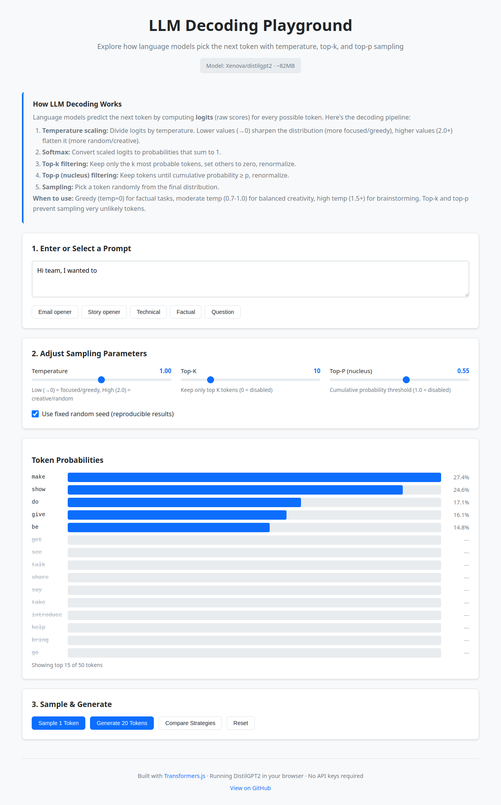
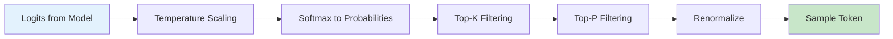
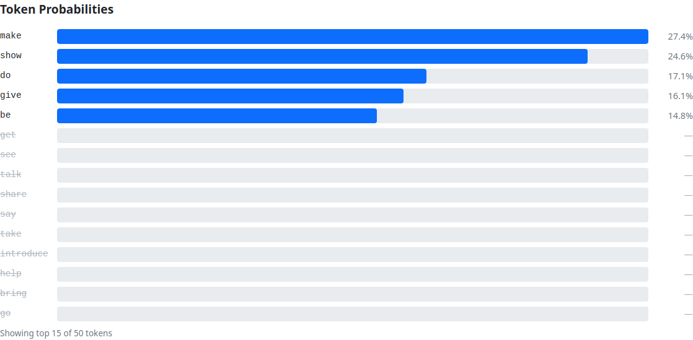
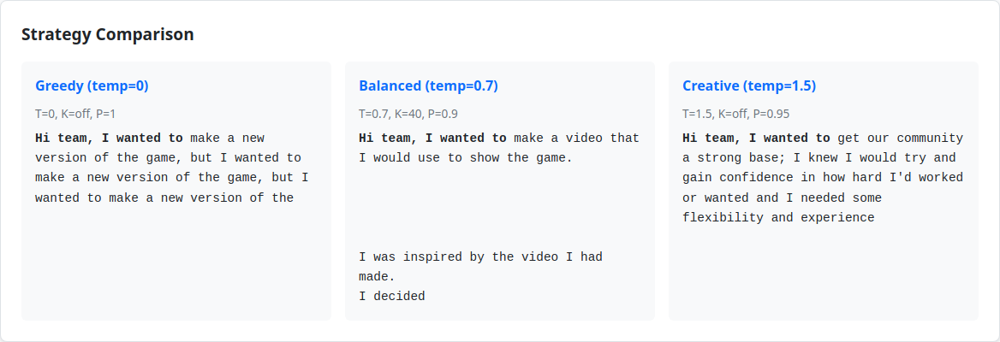

# LLM Decoding Playground

Interactive playground showing how language models pick the next token using temperature, top-k, and top-p (nucleus) sampling.

**[Live Demo →](https://fagun98.github.io/llm-decoding-playground/)**



## What is LLM Decoding?

Large Language Models (LLMs) generate text one token at a time. For each position, the model computes **logits** (raw scores) for every possible next token, then uses various **sampling strategies** to pick one. This playground lets you explore how different parameters affect that choice.

## Features

- **Real Model Inference**: Uses [DistilGPT2](https://huggingface.co/distilgpt2) running fully in your browser via [Transformers.js](https://huggingface.co/docs/transformers.js)
- **Interactive Visualization**: See live probability distributions as bar charts
- **Parameter Controls**: Adjust temperature, top-k, and top-p with real-time feedback
- **Visual Filtering**: Tokens filtered by top-k/top-p are greyed out and crossed out
- **Step-by-step Generation**: Sample one token at a time or generate 20+ tokens automatically
- **Strategy Comparison**: Side-by-side view of greedy vs. balanced vs. high-temperature outputs
- **Reproducible Results**: Fixed random seed option for deterministic sampling
- **No Backend Required**: Everything runs client-side, no API keys needed

## How Each Parameter Works

### Temperature (T)

Temperature scales the logits before applying softmax:

- **Low (→ 0)**: Sharpens the distribution → more confident, repetitive, greedy
- **Medium (0.7-1.0)**: Balanced creativity and coherence
- **High (1.5+)**: Flattens the distribution → more random, diverse, sometimes nonsensical

**When to use**: Greedy (T=0) for factual answers, moderate (0.7-1.0) for creative writing, high (1.5+) for brainstorming.

### Top-K

Keeps only the K most probable tokens, sets others to zero, then renormalizes.

- **K=0**: Disabled (all tokens considered)
- **K=10-50**: Filters out unlikely tokens, reduces repetition

**When to use**: Combine with temperature to prevent very low-probability tokens from being sampled.

### Top-P (Nucleus Sampling)

Keeps tokens until cumulative probability ≥ P, then renormalizes.

- **P=1.0**: Disabled (all tokens considered)
- **P=0.9**: Keeps the smallest set of tokens whose probabilities sum to 90%

**When to use**: Dynamic filtering that adapts to the distribution's shape (sharp or flat). Often more natural than fixed top-k.

## The Decoding Pipeline



1. **Model Output**: Raw logits for each token in vocabulary
2. **Temperature Scaling**: Divide logits by temperature
3. **Softmax**: Convert to probabilities that sum to 1
4. **Top-K Filter**: Keep only K highest-probability tokens
5. **Top-P Filter**: Keep tokens until cumulative probability ≥ P
6. **Renormalize**: Ensure remaining probabilities sum to 1
7. **Sample**: Pick a token randomly (or greedily if T=0)

## Tech Stack

- **React 18** with TypeScript
- **Vite** for build tooling
- **Vitest** for unit testing
- **Transformers.js** for client-side LLM inference
- **GitHub Actions** for CI/CD
- **GitHub Pages** for hosting

## Model Details

- **Model**: [Xenova/distilgpt2](https://huggingface.co/Xenova/distilgpt2) (ONNX port of DistilGPT2 for Transformers.js)
- **Size**: ~82MB quantized ONNX (`decoder_model_merged_quantized.onnx`)
- **Serving**: Vendored under `public/models/Xenova/distilgpt2/` and loaded same-origin (avoids Hugging Face CORS issues on localhost / GitHub Pages)
- **Inference**: Real next-token logits from the model in the browser via WebAssembly (ONNX Runtime Web)
- **Sampling**: Temperature, top-k, top-p, renormalisation, and seeded sampling are implemented from scratch in TypeScript (`src/utils/sampling.ts`) and unit-tested

## Project Structure

```
llm-decoding-playground/
├── src/
│   ├── components/              # React UI
│   │   ├── PromptInput.tsx
│   │   ├── ControlPanel.tsx
│   │   ├── ProbabilityChart.tsx
│   │   ├── GenerationPanel.tsx
│   │   └── Explainer.tsx
│   ├── utils/
│   │   ├── sampling.ts          # Temperature / top-k / top-p (from scratch)
│   │   ├── sampling.test.ts
│   │   └── model.ts             # Transformers.js DistilGPT2 wrapper
│   ├── App.tsx
│   ├── App.css
│   └── main.tsx
├── public/models/Xenova/distilgpt2/   # Vendored quantized ONNX (~82MB)
├── assets/                            # Real UI screenshots
├── scripts/capture-screenshots.mjs
├── .github/workflows/
│   ├── ci.yml
│   └── deploy.yml
├── package.json
├── vite.config.ts
└── README.md
```

## Local Development

### Prerequisites

- Node.js 18+ and npm

### Install & Run

```bash
# Install dependencies
npm install

# Run dev server (with HMR)
npm run dev

# Open http://localhost:5173 in your browser
```

### Build & Preview

```bash
# Type check
npm run typecheck

# Run tests
npm run test

# Lint
npm run lint

# Production build
npm run build

# Preview production build
npm run preview
```

## Testing

The sampling logic is fully unit-tested:

```bash
npm test
```

Tests cover:
- Temperature scaling
- Softmax normalization (probabilities sum to 1)
- Top-k filtering and renormalization
- Top-p (nucleus) filtering edge cases
- Seeded random number generation (deterministic sampling)
- Greedy decoding (temperature → 0)
- Full decoding pipeline

## Deployment

Deployed to GitHub Pages via GitHub Actions on every push to `main`:

1. Runs CI (lint, typecheck, test, build)
2. Uploads build artifact
3. Deploys to `https://fagun98.github.io/llm-decoding-playground/`

The `base` path in `vite.config.ts` is set to `/llm-decoding-playground/` for correct asset loading on GitHub Pages.

## Screenshots

### Main Interface


### Probability Distribution with Filtering


### Strategy Comparison


## Inspiration

This project draws inspiration from:
- [Jev-vs-LLM](https://github.com/fagun98/Jev-vs-LLM) - Interactive LLM visualization
- [Tokenizer Playground](https://github.com/fagun98/tokenizer-playground) - Tokenization explorer

## License

MIT License - see [LICENSE](LICENSE) file for details.

## Acknowledgments

- [Transformers.js](https://huggingface.co/docs/transformers.js) by Hugging Face for in-browser ML
- [DistilGPT2](https://huggingface.co/distilgpt2) model
- Inspired by the broader LLM visualization community

---

Built for the LinkedIn community — no API keys, no backend, just browser-based learning.
